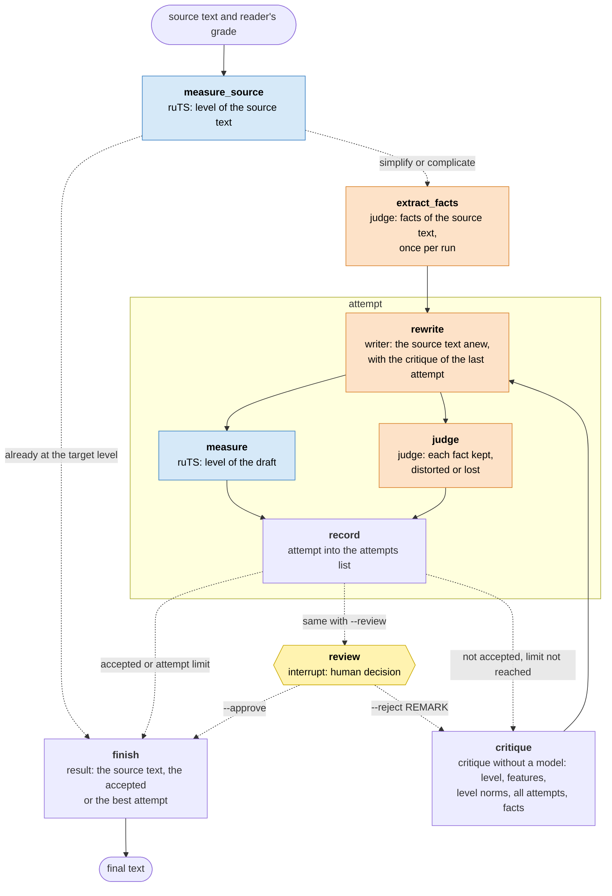

<h1 align="center">ruTS-adapt</h1>

<p align="center">
  <b>Adapting Russian texts to a reader's level</b> - a LangGraph graph where a model rewrites the text and <a href="https://github.com/SergeyShk/ruTS">ruTS</a> measures its level
</p>

<p align="center">
  <a href="https://github.com/SergeyShk/ruTS-adapt/blob/master/README.md">Русский</a>
</p>

<p align="center">
  <a href="https://github.com/SergeyShk/ruTS-adapt/actions/workflows/ci.yml"></a>
  <a href="https://github.com/astral-sh/ruff"></a>
  <a href="https://github.com/SergeyShk/ruTS-adapt/blob/master/LICENSE.txt"></a>
</p>

---

**ruTS-adapt** rewrites a Russian text for a reader of a given school grade, simplifying or complicating it. Then it checks the result instead of trusting the model: the [ruTS](https://github.com/SergeyShk/ruTS) library measures the text's level with readability formulas, and an LLM judge verifies that the new text keeps every fact of the original.

* **Both directions** - simplifies a scientific article for a young pupil or raises a fairy tale to a high-school level
* **Checked, not promised** - a text is accepted only if ruTS places it in the target level and the judge finds no lost or distorted facts
* **Several attempts** - an attempt that is not accepted gets a critique: how much harder or easier it is than the target, what to change, which facts to restore. The text is then rewritten; after the attempt limit the best attempt is chosen
* **Any model** - Claude by default, OpenAI, Gemini or a local Ollama model, separately for the writer and the judge
* **Stop and resume** - the state is saved after every step: an interrupted run resumes where it stopped, and the run can pause before the result for a human check

The command, its messages and the adapted texts are in Russian.

## Installation

ruTS-adapt runs from a clone of the repository. It needs [uv](https://docs.astral.sh/uv/getting-started/installation/), which installs Python 3.11+ and the dependencies:

```bash
git clone https://github.com/SergeyShk/ruTS-adapt.git
cd ruTS-adapt
uv sync
```

The default model needs an Anthropic API key:

```bash
export ANTHROPIC_API_KEY=...
```

## Usage

A text from a file for a 2nd-grade reader:

```bash
uv run ruts-adapt -g 2 photosynthesis.txt > simple.txt
```

Without a file the text is read from stdin. The final text goes to stdout, the progress and the table of attempts go to stderr. For example, a paragraph about photosynthesis from a biology textbook:

> Фотосинтез представляет собой сложный многоступенчатый процесс преобразования энергии солнечного излучения в энергию химических связей органических соединений, осуществляемый хлоропластами растительных клеток. В ходе световой фазы молекулы хлорофилла поглощают кванты света, вследствие чего происходит фотолиз воды...

```text
Поток d14f7b6c: продолжить после остановки - ruts-adapt --thread d14f7b6c
Исходный текст: «аспирантура (старше 22 лет)», сводный класс 22.0, 160 слов; упрощаем до «1-3-й класс (6-8 лет)»
Фактов в исходном тексте: 30
Попытка 1: черновик готов
Попытка 1: факты - сохранено 30, искажено 0, потеряно 0
Попытка 1: «1-3-й класс (6-8 лет)», сводный класс 2.0

Попытка   Класс  Ступень                      Слов в предл.  Слогов  Букв  От 5 слогов  MTLD   Факты с/и/п
исходный  22.0   аспирантура (старше 22 лет)  20.0           3.59    8.31  30%          265.5  -
1 *       2.0    1-3-й класс (6-8 лет)        6.6            2.09    4.81  2%           122.1  30/0/0

Готово: попытка 1 на уровне цели, все факты сохранены
```

> Растения умеют делать себе еду из солнечного света. Это зовут фотосинтезом. Дело это трудное, и идёт оно по шагам. Энергия солнца переходит в вещества и в них хранится. Всё это идёт в клетках растений. Там есть малые зелёные тельца, они и делают эту работу.
>
> Первый шаг зовут световым. Зелёное вещество листа ловит свет. От света вода делится на части. Из воды выходит кислород...

The table lists the features that the grade formulas are built from: sentence length in words, word length in syllables and letters, the share of words with five or more syllables. It also shows the MTLD lexical diversity and the fact check: kept, distorted, lost. An asterisk marks the final attempt. The table also has the tokens of each attempt (omitted in the example), and at the end the command prints the tokens spent by all model calls: a paragraph like this one takes about 11 thousand tokens per attempt with the default model, including fact extraction.

The reader's grade `-g` is a school grade from 1 to 11 or a year of university from 12 to 17. The target is the level it belongs to:

| `-g` | Level |
| :-- | :-- |
| 1-3 | grades 1-3 (ages 6-8) |
| 4-6 | grades 4-6 (ages 9-11) |
| 7-9 | grades 7-9 (ages 12-14) |
| 10-11 | grades 10-11 (ages 15-16) |
| 12-14 | university years 1-3 (ages 17-19) |
| 15-17 | university years 4-6 (ages 20-22) |

A text is at the target level if the ruTS consensus grade, the median of the readability formulas, falls into that level. If the source text is already at the level, the command returns it as is without calling the model. On a text shorter than 100 words the consensus grade is unstable, and the command warns about it. `-n` sets the maximum number of attempts, from 1 to 10, 3 by default.

The exit code tells whether the text passed the check, which helps when processing many files:

| Code | Meaning | stdout |
| :-: | :-- | :-- |
| 0 | the text is at the target level with all facts kept, or the source text is already at the level | the final text |
| 3 | no attempt passed the check, the best one is chosen | the best attempt |
| 4 | a candidate waits for a decision (`-r`) | empty |
| 1 | a model or storage error | empty |
| 2 | invalid arguments, settings or text; the thread is busy with another run | empty |
| 130 | Ctrl+C | empty |

### Human review and resuming

Every run is an adaptation thread with its own name, and its state is saved after every step. An interrupted run (Ctrl+C, a network failure, a provider limit) resumes by the thread name from the first line of the output:

```bash
uv run ruts-adapt --thread d14f7b6c
```

The hints in the command's output write `ruts-adapt` without `uv run`: that is how the command is called in an environment activated with `source .venv/bin/activate`. One run works with a thread at a time: a second run of the same thread while the first one is going fails with an error.

With `-r` the command pauses before the result and waits for a decision. The thread name can be chosen:

```bash
uv run ruts-adapt -g 5 -r -t dorset dorset.txt              # pauses before the result
uv run ruts-adapt -t dorset --approve                       # accept the text
uv run ruts-adapt -t dorset --reject "без латинских названий"  # send it back with a remark
```

A rejected text is rewritten with the remark taken into account, even after the attempt limit, and waits for a decision again. The remark stays in force for later attempts too. `ruts-adapt -t dorset` without a decision shows the waiting candidate again.

## Models and settings

The writer rewrites the text; the judge extracts the facts of the source text and checks every attempt against them. The model of each role is set by an environment variable as `provider:model`:

```bash
export RUTS_ADAPT_JUDGE_MODEL=openai:gpt-5
```

| Provider | Example | API key |
| :-- | :-- | :-- |
| `anthropic` | `anthropic:claude-opus-5-5` | `ANTHROPIC_API_KEY` |
| `openai` | `openai:gpt-5` | `OPENAI_API_KEY` |
| `google_genai` | `google_genai:gemini-3.1-pro` | `GOOGLE_API_KEY` or `GEMINI_API_KEY` |
| `ollama` | `ollama:qwen3:30b` | none: a local [Ollama](https://ollama.com) server |

| Variable | What it sets | Default |
| :-- | :-- | :-- |
| `RUTS_ADAPT_WRITER_MODEL`, `RUTS_ADAPT_JUDGE_MODEL` | the writer's and the judge's model | `anthropic:claude-opus-5-5` |
| `RUTS_ADAPT_<WRITER\|JUDGE>_EFFORT` | reasoning effort: `low` … `max` for Anthropic, `none` … `max` for OpenAI, `minimal` … `high` for Gemini, `none` … `high` for Ollama; an empty value means the provider's default, and models without effort levels take only an empty value | `high` for the default model, otherwise the provider's default |
| `RUTS_ADAPT_<WRITER\|JUDGE>_MAX_TOKENS` | response limit including reasoning, in tokens | 64,000 for the default model and for Claude models whose limit LangChain does not know, otherwise the provider's default |
| `RUTS_ADAPT_<WRITER\|JUDGE>_CONTEXT` | context window of an Ollama model, in tokens | 32,768 |
| `RUTS_ADAPT_FALLBACKS` | Anthropic only: when the model refuses, retry the request on a fallback model, 1 or 0 | 1 |
| `RUTS_ADAPT_DATA_DIR` | directory with saved threads | the user data directory: `~/Library/Application Support/ruts-adapt`, `~/.local/share/ruts-adapt` or `%LOCALAPPDATA%\ruts-adapt` |

## How the graph works

The adaptation is a [LangGraph](https://langchain-ai.github.io/langgraph/) graph. Nodes are steps, edges are their order, and dashed edges choose a path from the state. The writer and the judge reach the nodes through the run context, not through the state, so a saved state can be resumed with other models.



Orange nodes call a model, blue ones measure the text with ruTS, the yellow one waits for a human, the rest work without a model.

| Node | What it does | What it writes to the state |
| :-- | :-- | :-- |
| `measure_source` | ruTS measures the source text: consensus grade, level and features | `source_measurement` |
| `extract_facts` | the judge extracts the facts of the source text - short statements that convey the meaning rather than the terms; one list for all attempts | `facts` |
| `rewrite` | the writer rewrites the source text for the target level; from the second attempt on it sees the previous draft and its critique | `draft`, `draft_tokens` |
| `measure` | ruTS measures the draft | `draft_measurement` |
| `judge` | the judge decides for each fact whether it is kept, distorted or lost, and quotes the draft | `checks`, `judge_tokens` |
| `record` | builds the attempt: text, level, fact checks, distance to the target level, tokens | `attempts` |
| `critique` | writes a critique without a model: how much harder or easier the text is than the target, its features next to the source's and the level norms (for grades 1-3 and 4-6), all previous attempts, distorted and lost facts, human remarks | `critique`, `previous`; resets `feedback` |
| `review` | stops the graph and waits for a human decision: accept the candidate or send it back with a remark | `feedback`, `remarks`, `rejected`, `rejected_after` |
| `finish` | chooses the result: the source text if it is already at the level, the accepted attempt or the best one; after a human sends a text back, only among the attempts written after that | `result` |

**Parallel branches.** `measure` and `judge` run in the same graph step, and `record` waits for both.

**State.** A node returns only the fields it changes. The list of attempts `attempts`, the human remarks `remarks` and the numbers of the attempts the human sent back `rejected` are declared with the `operator.add` reducer: LangGraph appends new items instead of replacing the list. Other fields keep the last value.

**Route after an attempt.** An attempt is accepted if the draft's consensus grade falls into the target level and the judge finds no distorted or lost facts; the graph then goes to the result. If the attempt is not accepted and the limit is not reached, the graph goes to the critique and the next attempt. After the limit, the result is the best attempt: fewer distorted and lost facts first, then closer to the level. After a human sends a text back, the choice is made only among the attempts written after that: the earlier ones lack the remark.

**Loop.** Every attempt rewrites the source text, not the previous draft, so errors do not accumulate. The critique is built from the ruTS measurements and the judge's verdict and does not depend on the model it evaluates.

**Retries.** A model node (`extract_facts`, `rewrite`, `judge`) is called up to three times with pauses of 2 and 4 s if a retry may help: the response does not match the schema, the model stopped unexpectedly, no facts were found in the text, the draft is empty or not in Russian, the judge did not rate every fact exactly once, the server is overloaded or failing, the rate limit is exceeded, the network dropped or the response timed out. A refusal, a response cut off by the token limit, a text that does not fit the context window, and an invalid key or request fail at once; such a run resumes by the thread name.

**Saving and resuming.** A SQLite checkpointer writes the thread state to `checkpoints.sqlite` in the data directory after every step; the thread name is the `thread_id`. The `review` node calls `interrupt`: the graph stops, and `--approve` or `--reject` resume it through `Command(resume=...)`. An interrupted run resumes from the last saved step. After a run only the last checkpoint of the thread is kept: resuming needs nothing more.

## Development

How to run the tests and checks, and how the live runs against a real model work - see [CONTRIBUTING.md](https://github.com/SergeyShk/ruTS-adapt/blob/master/CONTRIBUTING.md) (in Russian).

## License

[MIT](https://github.com/SergeyShk/ruTS-adapt/blob/master/LICENSE.txt)
