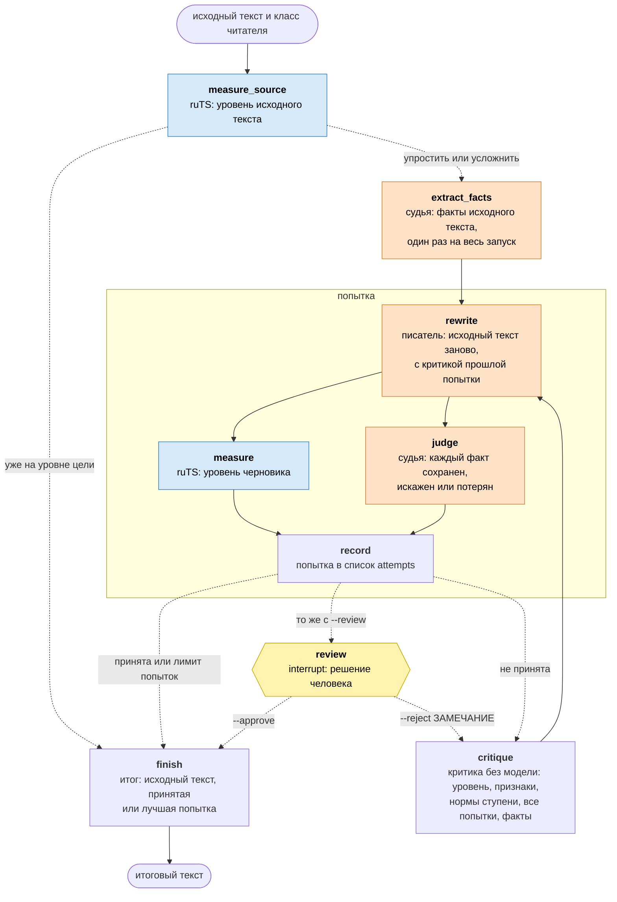

<h1 align="center">ruTS-adapt</h1>

<p align="center">
  <b>Адаптация русского текста под уровень читателя</b> - граф LangGraph, в котором текст переписывает модель, а уровень измеряет <a href="https://github.com/SergeyShk/ruTS">ruTS</a>
</p>

<p align="center">
  <a href="https://github.com/SergeyShk/ruTS-adapt/blob/master/README.en.md">English</a>
</p>

<p align="center">
  <a href="https://github.com/SergeyShk/ruTS-adapt/actions/workflows/ci.yml"></a>
  <a href="https://github.com/astral-sh/ruff"></a>
  <a href="https://github.com/SergeyShk/ruTS-adapt/blob/master/LICENSE.txt"></a>
</p>

---

**ruTS-adapt** переписывает русский текст для читателя заданного класса, упрощая или усложняя его, и проверяет результат, а не верит модели на слово. Уровень текста измеряет библиотека [ruTS](https://github.com/SergeyShk/ruTS) по формулам удобочитаемости, а LLM-судья сверяет, что в новом тексте остались все факты исходного.

* **В обе стороны** - упрощает научную статью для младшего школьника или усложняет сказку до уровня старшеклассника
* **Проверка вместо обещания** - текст принимается, только если ruTS относит его к ступени цели, а судья не нашел ни потерянных, ни искаженных фактов
* **Несколько попыток** - непринятый текст получает критику: насколько он сложнее или проще цели, что в нем менять, какие факты вернуть; затем пишется заново, а после лимита попыток выбирается лучший
* **Любая модель** - Claude по умолчанию, OpenAI, Gemini или локальная модель Ollama, отдельно для писателя и судьи
* **Остановка и продолжение** - состояние сохраняется после каждого шага: прерванный запуск продолжается с места остановки, а перед итогом можно остановиться и проверить текст самому

## Установка

ruTS-adapt запускается из клона репозитория. Нужен [uv](https://docs.astral.sh/uv/getting-started/installation/), он сам поставит Python 3.11+ и зависимости:

```bash
git clone https://github.com/SergeyShk/ruTS-adapt.git
cd ruTS-adapt
uv sync
```

Модели по умолчанию нужен ключ API Anthropic:

```bash
export ANTHROPIC_API_KEY=...
```

## Использование

Текст из файла для читателя 2-го класса:

```bash
uv run ruts-adapt -g 2 photosynthesis.txt > simple.txt
```

Без файла текст читается из stdin. Итоговый текст печатается в stdout, ход работы и таблица попыток - в stderr. Например, абзац о фотосинтезе из учебника биологии:

> Фотосинтез представляет собой сложный многоступенчатый процесс преобразования энергии солнечного излучения в энергию химических связей органических соединений, осуществляемый хлоропластами растительных клеток. В ходе световой фазы молекулы хлорофилла поглощают кванты света, вследствие чего происходит фотолиз воды...

```text
Поток d14f7b6c: продолжить после остановки - ruts-adapt --thread d14f7b6c
Исходный текст: «аспирантура (старше 22 лет)», сводный класс 22.0, 160 слов; упрощаем до «1-3-й класс (6-8 лет)»
Фактов в исходном тексте: 30
Попытка 1: черновик готов
Попытка 1: факты - сохранено 30, искажено 0, потеряно 0
Попытка 1: «1-3-й класс (6-8 лет)», сводный класс 2.0

Попытка   Класс  Ступень                      Слов в предл.  Слогов  Букв  От 5 слогов  MTLD   Факты с/и/п
исходный  22.0   аспирантура (старше 22 лет)  20.0           3.59    8.31  30%          265.5  -
1 *       2.0    1-3-й класс (6-8 лет)        6.6            2.09    4.81  2%           122.1  30/0/0

Готово: попытка 1 на уровне цели, все факты сохранены
```

> Растения умеют делать себе еду из солнечного света. Это зовут фотосинтезом. Дело это трудное, и идёт оно по шагам. Энергия солнца переходит в вещества и в них хранится. Всё это идёт в клетках растений. Там есть малые зелёные тельца, они и делают эту работу.
>
> Первый шаг зовут световым. Зелёное вещество листа ловит свет. От света вода делится на части. Из воды выходит кислород...

В таблице - признаки, из которых складываются формулы класса: длина предложения в словах, длина слова в слогах и буквах, доля слов от пяти слогов, а также лексическое разнообразие MTLD и проверка фактов: сохранено, искажено, потеряно. Звездочка отмечает итоговую попытку. Еще в таблице есть токены каждой попытки (в примере опущены), а в конце команда печатает, сколько токенов потратили все вызовы модели: на такой абзац с моделью по умолчанию уходит около 11 тыс. токенов на попытку вместе с выпиской фактов.

Класс читателя `-g` - это класс школы от 1 до 11 или год обучения в вузе от 12 до 17. Целью служит ступень, к которой он относится:

| `-g` | Ступень |
| :-- | :-- |
| 1-3 | 1-3-й класс (6-8 лет) |
| 4-6 | 4-6-й класс (9-11 лет) |
| 7-9 | 7-9-й класс (12-14 лет) |
| 10-11 | 10-11-й класс (15-16 лет) |
| 12-14 | 1-3-й курс вуза (17-19 лет) |
| 15-17 | 4-6-й курс вуза (20-22 года) |

Текст на уровне цели, если сводный класс ruTS - медиана формул удобочитаемости - попадает в эту ступень. Если исходный текст уже на уровне, команда возвращает его как есть, не вызывая модель. `-n` задает наибольшее число попыток, от 1 до 10, по умолчанию 3.

### Проверка человеком и продолжение

Каждый запуск - поток адаптации со своим именем, его состояние сохраняется после каждого шага. Прерванный запуск (Ctrl+C, сбой сети, лимит провайдера) продолжается командой из первой строки вывода:

```bash
uv run ruts-adapt --thread d14f7b6c
```

С `-r` команда останавливается перед итогом и ждет решения. Имя потока можно задать самому:

```bash
uv run ruts-adapt -g 5 -r -t dorset dorset.txt              # остановится перед итогом
uv run ruts-adapt -t dorset --approve                       # принять текст
uv run ruts-adapt -t dorset --reject "без латинских названий"  # вернуть с замечанием
```

Возвращенный текст переписывается с учетом замечания, даже если лимит попыток исчерпан, и снова ждет решения. Замечание остается в силе и для следующих попыток.

## Модели и настройки

Писатель переписывает текст, судья выписывает факты исходного текста и проверяет по ним каждую попытку. Модель каждой роли задается переменной окружения в виде `провайдер:модель`:

```bash
export RUTS_ADAPT_JUDGE_MODEL=openai:gpt-5
```

| Провайдер | Пример | Ключ API |
| :-- | :-- | :-- |
| `anthropic` | `anthropic:claude-opus-5-5` | `ANTHROPIC_API_KEY` |
| `openai` | `openai:gpt-5` | `OPENAI_API_KEY` |
| `google_genai` | `google_genai:gemini-2.5-pro` | `GOOGLE_API_KEY` |
| `ollama` | `ollama:qwen3:30b` | не нужен: локальный сервер [Ollama](https://ollama.com) |

| Переменная | Что задает | По умолчанию |
| :-- | :-- | :-- |
| `RUTS_ADAPT_WRITER_MODEL`, `RUTS_ADAPT_JUDGE_MODEL` | модель писателя и судьи | `anthropic:claude-opus-5-5` |
| `RUTS_ADAPT_<WRITER\|JUDGE>_EFFORT` | усилие рассуждения: `low` … `max` у Anthropic, `none` … `xhigh` у OpenAI, `minimal` … `high` у Gemini, `none` … `high` у Ollama; пустое значение - умолчание провайдера | `high` у модели по умолчанию, иначе умолчание провайдера |
| `RUTS_ADAPT_<WRITER\|JUDGE>_MAX_TOKENS` | лимит ответа вместе с рассуждением, в токенах | 64 000 у модели по умолчанию, иначе умолчание провайдера |
| `RUTS_ADAPT_<WRITER\|JUDGE>_CONTEXT` | окно контекста модели Ollama, в токенах | 32 768 |
| `RUTS_ADAPT_FALLBACKS` | у Anthropic: при отказе модели повторить запрос на резервной модели, 1 или 0 | 1 |
| `RUTS_ADAPT_DATA_DIR` | каталог с сохраненными потоками | каталог данных пользователя: `~/Library/Application Support/ruts-adapt`, `~/.local/share/ruts-adapt` или `%LOCALAPPDATA%\ruts-adapt` |

## Как устроен граф

Адаптация - граф [LangGraph](https://langchain-ai.github.io/langgraph/). Узлы - шаги работы, ребра - порядок шагов, пунктирные ребра - выбор пути по состоянию. Писатель и судья приходят в узлы через контекст запуска, а не через состояние, поэтому состояние можно сохранить и продолжить с другими моделями.



Оранжевые узлы вызывают модель, синие измеряют текст ruTS, желтый ждет человека, остальные работают без модели.

| Узел | Что делает | Что пишет в состояние |
| :-- | :-- | :-- |
| `measure_source` | ruTS измеряет исходный текст: сводный класс, ступень и признаки | `source_measurement` |
| `extract_facts` | судья выписывает факты исходного текста - короткие утверждения, которые передают смысл, а не термины; список один на все попытки | `facts` |
| `rewrite` | писатель переписывает исходный текст под ступень цели; со второй попытки он видит прошлый черновик и критику к нему | `draft` |
| `measure` | ruTS измеряет черновик | `draft_measurement` |
| `judge` | судья решает про каждый факт, сохранен он, искажен или потерян, и приводит цитату из черновика | `checks` |
| `record` | собирает попытку: текст, уровень, проверки фактов, расстояние до ступени, токены | `attempts` |
| `critique` | пишет критику без модели: насколько текст сложнее или проще цели, его признаки рядом с исходными и с нормами ступени, все прошлые попытки, искаженные и потерянные факты, замечания человека | `critique`, `previous` |
| `review` | останавливает граф и ждет решения человека: принять кандидата или вернуть с замечанием | `feedback`, `remarks`, `rejected` |
| `finish` | выбирает итог: исходный текст, если он уже на уровне, принятую попытку или лучшую из всех | `result` |

**Параллельные ветви.** `measure` и `judge` выполняются в одном шаге графа, а `record` ждет обе ветви.

**Состояние.** Узел возвращает только поля, которые меняет. Список `attempts` и списки замечаний `remarks` и `rejected` объявлены с редьюсером `operator.add`: LangGraph дописывает к ним новые элементы, а не заменяет их. Остальные поля хранят последнее значение.

**Маршрут после попытки.** Попытка принята, если сводный класс черновика попал в ступень цели и судья не нашел ни искаженных, ни потерянных фактов. Тогда граф идет к итогу. Если попытка не принята, а лимит не исчерпан, граф идет к критике и следующей попытке. После лимита итогом становится лучшая попытка: сначала меньше искаженных и потерянных фактов, затем ближе к ступени.

**Цикл.** Каждая попытка переписывает исходный текст, а не прошлый черновик, поэтому ошибки не накапливаются. Критика строится по измерениям ruTS и вердикту судьи и не зависит от модели, которую оценивает.

**Повторы.** Узел с моделью (`extract_facts`, `rewrite`, `judge`) вызывается до трех раз, если ответ не по схеме или модель неожиданно остановилась. Отказ модели и ответ, обрезанный по лимиту токенов, - ошибка сразу.

**Сохранение и продолжение.** Чекпоинтер SQLite пишет состояние потока в `checkpoints.sqlite` в каталоге данных после каждого шага; имя потока - `thread_id`. Узел `review` вызывает `interrupt`: граф останавливается, а `--approve` или `--reject` продолжают его через `Command(resume=...)`. Прерванный запуск продолжается с последнего сохраненного шага.

## Разработка

Как запустить тесты и проверки, как устроены живые прогоны на настоящей модели - в [CONTRIBUTING.md](https://github.com/SergeyShk/ruTS-adapt/blob/master/CONTRIBUTING.md).

## Лицензия

[MIT](https://github.com/SergeyShk/ruTS-adapt/blob/master/LICENSE.txt)
